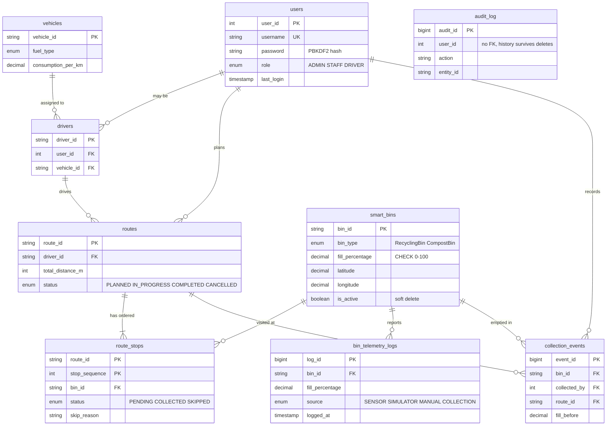

# GreenPulse entity-relationship diagram

## Design notes

- `smart_bins` uses single-table inheritance: recycling bins fill `contamination_percentage`, compost bins fill `moisture_level` and `temp_celsius`, and the other columns stay `NULL`. The model layer hides this behind `SensorReading`.
- `bin_telemetry_logs` is append-only and indexed on `(bin_id, logged_at)` for trend queries.
- `audit_log` deliberately has no foreign keys so the history survives deleted users and bins.
- `drivers.assigned_vehicle` is a legacy free-text column kept for databases created by older versions; `vehicle_id` is the normalized replacement.
